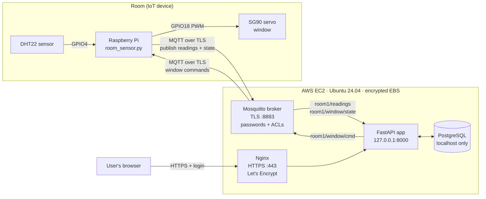

# System Architecture

## Data flow

1. **Sense:** the Pi reads the DHT22 every 30 s.
2. **Publish:** the Pi sends JSON to `room1/readings` over TLS, logged in as MQTT user `pi`.
3. **Store:** FastAPI (MQTT user `server`) receives it and inserts one `reading` row per sensor (temperature and humidity).
4. **Decide:** if the temperature crosses a threshold, FastAPI publishes to `room1/window/cmd`.
5. **Act:** the Pi moves the servo and publishes the real state to `room1/window/state`, which is saved in `window_event`.
6. **View:** the user logs in over HTTPS. The dashboard calls `/api/sensor_readings` and `/api/window` every 10 s.

## Database tables

| Table | Columns |
|---|---|
| `user` | id, username, email, password_hash (bcrypt) |
| `reading` | id, sensor (temperature/humidity), content, date_timestamp |
| `window_event` | id, state (open/closed), reason (auto/manual/startup), date_timestamp |
| `setting` | id, open_at, close_at |

## MQTT topics and ACLs

| Topic | Publisher | Subscriber |
|---|---|---|
| `room1/readings` | pi | server |
| `room1/window/state` | pi | server |
| `room1/window/cmd` | server | pi |

Anything not listed is denied. Anonymous clients are rejected.

## Where data is secured

| Hop | In transit | At rest |
|---|---|---|
| Pi → broker | TLS 1.2+ on 8883, username/password | MQTT credentials in `.env` on the Pi |
| Broker → FastAPI | TLS 1.2+ on 8883, separate user | – |
| FastAPI → PostgreSQL | localhost only, password auth | Encrypted EBS volume |
| Browser → Nginx | HTTPS + HSTS | Passwords bcrypt-hashed |
